# Module 3: Governed Business Context-Rich Answers from Multi-Source Data Products with SAP Business Data Cloud
## Introduction

In this exercise, you'll understand how SAP Business Data Cloud data products serve as the governed data layer for AI-powered analytics, SAP-delivered data products (PurchaseOrder, Supplier) and custom products (Supplier Risk Score) are pre-modeled and ready to consume using SAP Generative AI Hub and SAP BTP connectivity services. The assistant answers natural language questions over governed, multi-source data, from basic single-service queries to complex three-service analytical questions spanning PO history, supplier master, and risk scores with no hallucination.

You'll learn how to:
### Demo Section
- SAP Business Data Cloud, Data Products.
- SAP Datasphere, Analytic Models & Views Governed Layer with SAP and Non-SAP data sources.
- SAP Datasphere, V4 Odata Consumption Services.
- Configure SAP BTP Destination service to estabilish secure connection with SAP Datasphere.

### Hands-on Section
- Connect SAP AI Core (GPT-5) to extract business parameters from natural language questions Connect an AI agent to SAP Business Data Cloud through a Cloud Foundry proxy app using BTP Destination Service and OData services exposed from SAP Datasphere.
- Design governed business operations that map natural language questions to the right OData service: AM_PO_HISTORY for spend/delivery, V_SUPPLIER for master data, AM_SUPPLIER_RISK_SCORE for risk analytics.
- Author LLM tool schemas that reflect data product semantics:expose the right fields, guide the LLM to use pre-computed measures (e.g., CountPurchaseOrder) instead of counting raw rows, and set appropriate parameter constraints.
- Build a system prompt that teaches the LLM domain context:risk scoring logic (weighted dimensions), aggregation rules, and multi-service orchestration pattern.
- Orchestrate multi-round, multi-service LLM tool calls: the LLM autonomously chains calls across three services (e.g., get risk scores → resolve supplier names → combine into a single answer) without human intervention.
- Ask natural language questions over governed, multi-source data, from basic single-service queries to complex three-service analytical questions spanning PO history, supplier master, and risk scores.

### 🏗️ Architecture: Module 3 SAP BDC Data Products Connectivity with Business context and semantics

```
┌─────────────────┐         HTTPS           ┌─────────────────────────────────────┐
│                 │ ──────────────────────► │  bdc_connectivity.py                │
│    Notebook     │                         │  (Cloud Foundry App on SAP BTP)     │
│                 │ ◄────────────────────── │                                     │
│                 │        JSON Response    └──────────┬──────────────────────────┘
└─────────────────┘                                    │
                                                       │  /odata
                                                       ▼
                                          ┌─────────────────────────────┐
                                          │  BTP Destination Service    │
                                          │  (Credentials + Routing)    │
                                          └──────────┬──────────────────┘
                                                     │
                                                     ▼
                                          ┌─────────────────────────────┐
                                          │    SAP Datasphere           │
                                          │    (OData V2/V4 Service)    │
                                          └──────────┬──────────────────┘
                                                     │
                                                     ▼
┌────────────────────────────────────────────────────────────────────────────────┐
│                SAP Datasphere — Analytic Models & Views                        │
│                                                                                │
│  ┌──────────────────┐  ┌──────────────────┐  ┌─────────────────────────────┐   │
│  │ AM_PO_HISTORY    │  │ V_SUPPLIER       │  │ AM_SUPPLIER_RISK_SCORE      │   │
│  │ (PO Fact)        │  │ (Supplier Dim)   │  │ (Risk Fact)                 │   │
│  └────────┬─────────┘  └────────┬─────────┘  └──────────┬──────────────────┘   │
│           │                     │                       │                      │
│           │                     │                       │                      │ 
│           │                     │                       │                      │
│           ▼                     ▼                       ▼                      │
│  ┌─────────────────────────────────────────────────────────────────────────┐   │
│  │                SAP BDC Data Products (SAP Sources)                      │   │
│  │                                                                         │   │
│  │  ┌───────────────────┐ ┌───────────────────┐ ┌──────────────────────┐   │   │
│  │  │ PurchaseOrder     │ │PurchaseOrderItem  │ │PurchaseOrder         │   │   │
│  │  │                   │ │                   │ │ScheduleLine          │   │   │
│  │  └───────────────────┘ └───────────────────┘ └──────────────────────┘   │   │
│  │                                                                         │   │
│  │  ┌───────────────────┐                                                  │   │
│  │  │ Supplier          │                                                  │   │
│  │  └───────────────────┘                                                  │   │
│  └─────────────────────────────────────────────────────────────────────────┘   │
│                                                                                │
│  ┌─────────────────────────────────────────────────────────────────────────┐   │
│  │                External Data (Non-SAP Sources)                          │   │
│  │                                                                         │   │
│  │  ┌──────────────────────────────┐                                       │   │
│  │  │ EXT_COUNTRY_RISK_INDEX       │                                       │   │
│  │  │ (Country Risk Scores, CSV)   │                                       │   │
│  │  └──────────────────────────────┘                                       │   │
│  └─────────────────────────────────────────────────────────────────────────┘   │
└────────────────────────────────────────────────────────────────────────────────┘
```
---

## Architecture

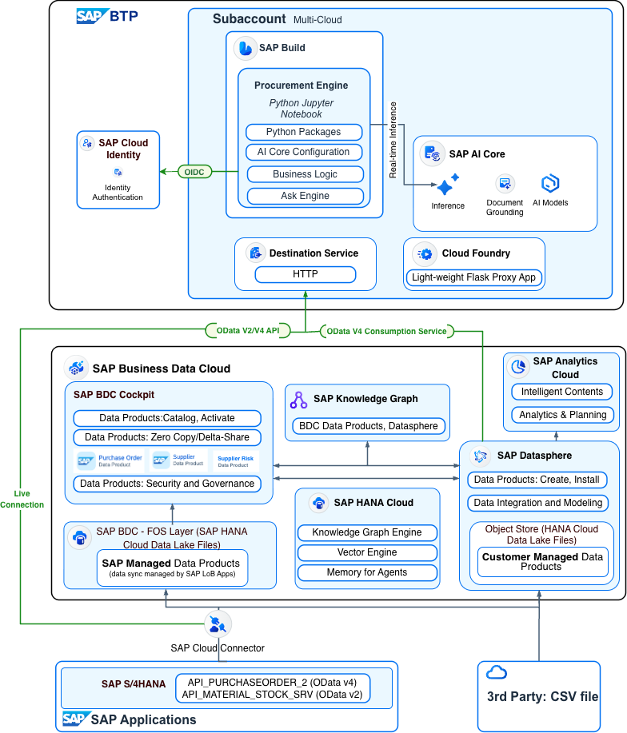

---

## Prerequisite for Bring Your Own Tenant (BYOT)

> **Note:** If you are unable to bring your own tenant, sign up for a [free SAP BTP Trial Account](https://discovery-center.cloud.sap/card/58250857-1c8e-440f-800a-a264969a3bc8) and a [free SAP Business Application Studio](https://help.sap.com/docs/bas/sap-business-application-studio/getting-started-with-trial-account)ensure both are fully set up and accessible before the hands-on session. Trial provisioning can take up to 24 hours. Please do not wait until the day of the workshop.
 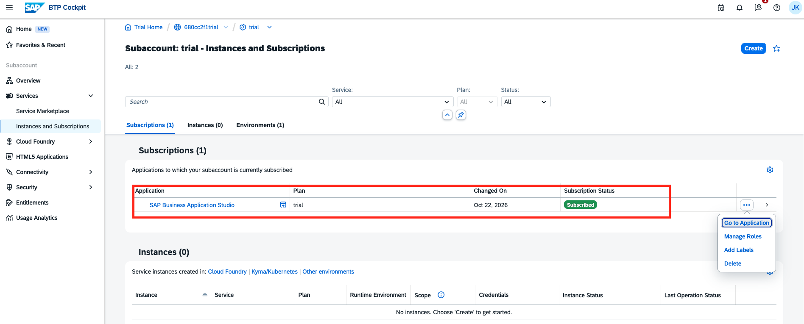


Before the day of the session, ensure you have access to the required applications and that configuration and setup are completed:

### 1. SAP Business Data Cloud & SAP Datasphere

| Role | Purpose | Needed For |
|---|---|---|
| DW Space Administrator | Create and manage spaces, assign members | Creating AI_DATA_CONTEXT_FOUNDATION space |
| DW Modeler | Create SQL views, analytic models, manage tables | Building V_SUPPLIER_RISK_SCORE, AM_PO_HISTORY, AM_SUPPLIER_RISK_SCORE |
| DW Integrator | Import data products, load external data | Importing SAP BDC data products (PurchaseOrder, Supplier), uploading EXT_COUNTRY_RISK_INDEX CSV |
| DW Data Consumer | Expose views/models for consumption via OData | Enabling "Expose for Consumption" on analytic models |

### 2. SAP BTP Subaccount

| Role / Entitlement | Purpose | Needed For |
|---|---|---|
| Subaccount Administrator | Manage services, destinations, CF org | Overall setup |
| Destination Administrator | Create and configure BTP destinations | Creating BDC-AI-Data-Foundation destination pointing to Datasphere |
| Cloud Foundry Org Manager / Space Developer | Deploy and manage CF apps | Deploying bdc_connectivity.py proxy app |
| Destination Service (entitlement) | Lookup destination config at runtime | CF app binding — module3_bdc service instance |
| SAP AI Core (entitlement) | LLM inference | GPT-5 deployment for natural language processing |
| AI Launchpad access | Manage deployments, get service keys | Retrieving AI Core credentials and deployment URL |

### 3. SAP Business Application Studio (SAP Build Code)

| Role | Purpose | Needed For |
|---|---|---|
| Business_Application_Studio_Developer | Access BAS dev spaces | Running the Jupyter notebook |
| Dev Space: Full-Stack Cloud Application | Python runtime, terminal access | Executing notebook cells, creating venv |

### 4. SAP AI Core Deployment

A running **SAP AI Core** deployment with GPT-5 (or any model of your choice), including your deployment URL and service key (`clientid`, `clientsecret`, `url`, `AI_API_URL`) for the `.env` file.

Gather the following values before the session and have them ready to paste into your `.env` file:

| `.env` Variable | Value | Where to Find It |
|---|---|---|
| `AICORE_AUTH_URL` | AI Core OAuth URL (e.g. `https://<subaccount>.authentication.<region>.hana.ondemand.com`) | BTP Cockpit → Instances → AI Core → Service Key → `url` |
| `AICORE_CLIENT_ID` | AI Core client ID (e.g. `sb-xxxxxxxx!bxxxxxx\|aicore!b540`) | BTP Cockpit → Instances → AI Core → Service Key → `clientid` |
| `AICORE_CLIENT_SECRET` | AI Core client secret | BTP Cockpit → Instances → AI Core → Service Key → `clientsecret` |
| `GPT5_DEPLOYMENT_URL` | LLM deployment endpoint (e.g. `https://api.ai.prod.<region>.aws.ml.hana.ondemand.com/v2/inference/deployments/<id>`) | AI Launchpad → Deployments → your GPT-5 deployment → Deployment URL |
| `DESTINATION` | BTP Destination name pointing to SAP Datasphere (e.g. `BDC-AI-Data-Foundation`) | BTP Cockpit → Connectivity → Destinations → Destination Name |
| `BDC_PROXY_URL` | Cloud Foundry app route URL (e.g. `https://bdc-connection-xxxx.cfapps.<region>.hana.ondemand.com`) | BTP Cockpit → Cloud Foundry → Applications → your app → Routes |

### Service Key to `.env` Mapping

Your AI Core service key JSON maps to the `.env` as follows:

```json
{
  "clientid":     "→  AICORE_CLIENT_ID",
  "clientsecret": "→  AICORE_CLIENT_SECRET",
  "url":          "→  AICORE_AUTH_URL",
  "serviceurls": {
    "AI_API_URL": "→  Base URL for GPT5_DEPLOYMENT_URL"
  }
}
```

`GPT5_DEPLOYMENT_URL` = `AI_API_URL` + `/v2/inference/deployments/<your-deployment-id>`

---

## Setup Steps

### Step 1: Activate SAP BDC Data Products

Activate SAP BDC Data Products `PurchaseOrder`, `PurchaseOrderItem`, `PurchaseOrderScheduleLine`, and `Supplier`.

Data Package: **SAP Sourcing and Procurement Data Products (SAP S/4HANA Cloud Private Edition)**. Refer to [SAP Business Data Cloud — Activating Data Products](https://help.sap.com/docs/business-data-cloud/administering-sap-business-data-cloud/activating-data-products) for detailed steps.

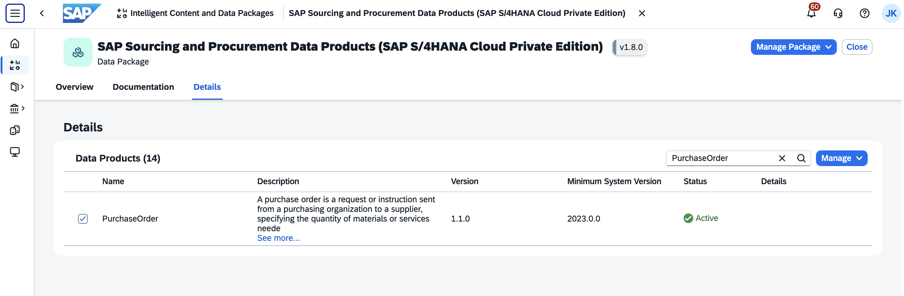

### Step 2: Prepare Datasphere Spaces

> **Important — Before You Begin:** This exercise uses two SAP Datasphere spaces:
> - **SAP Managed:** `RI4400`
> - **Customer Managed:** `AI_DATA_CONTEXT_FOUNDATION`
>
> The pre-built tables, models, and external dataset are provided as `.json` and `.csv` files, located in the `others` folder of the repository. Before importing, update the Space IDs in the `.json` files to match your landscape. A direct as-is import will fail without this adjustment.

### Step 3: Request Data Product Access

Request SAP BDC Data Products `PurchaseOrder`, `PurchaseOrderItem`, `PurchaseOrderScheduleLine`, and `Supplier` access into a SAP Datasphere space. Refer to [SAP Datasphere — Requesting Access to Data Products](https://help.sap.com/docs/SAP_DATASPHERE/c8a54ee704e94e15926551293243fd1d/ea7cb802cbea47b39a441888873c3a49.html) for detailed steps.

> **Note:** You can use an existing space, e.g. `AI_DATA_CONTEXT_FOUNDATION`

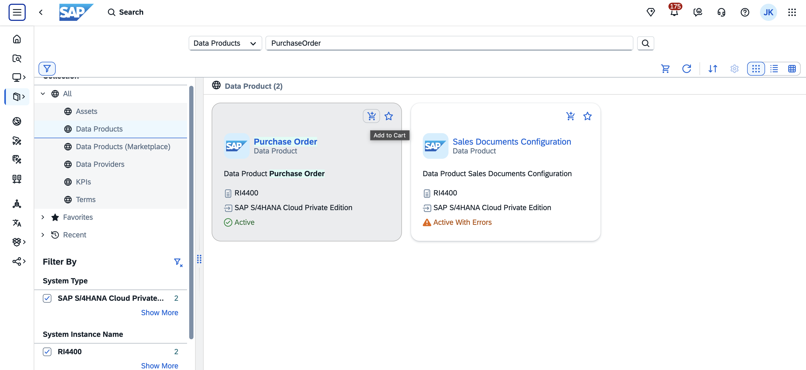

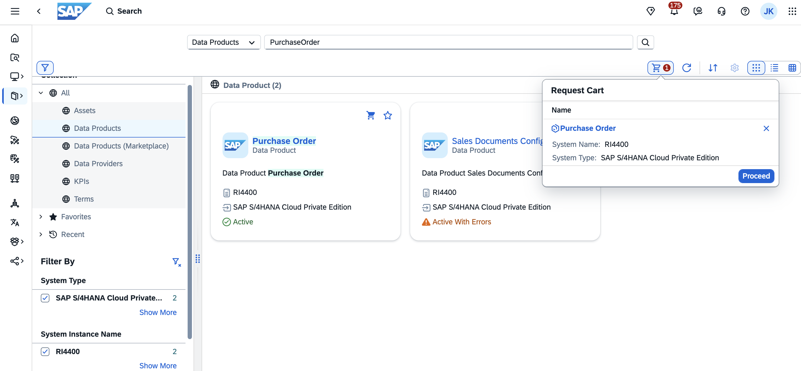

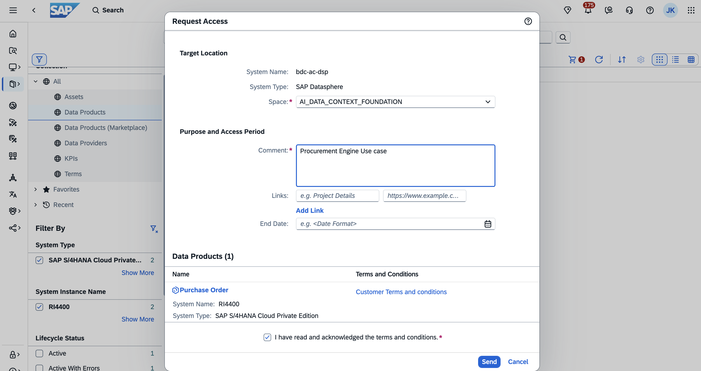

### Step 4: Import JSON Objects

In SAP Datasphere, Space `AI_DATA_CONTEXT_FOUNDATION`, import the following `.json` files:

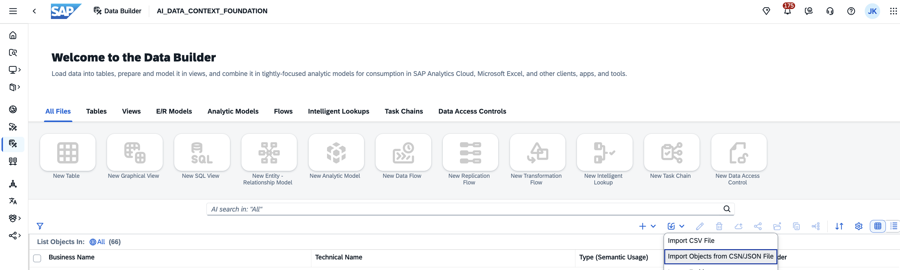

1. `EXT_COUNTRY_RISK_INDEX.json`
2. `IL_PO_ITEM.json`
3. `V_SUPPLIER.json`
4. `HL_PO_HISTORY.json`
5. `V_SUPPLIER_RISK_SCORE.json`
6. `AM_PO_HISTORY.json`
7. `AM_SUPPLIER_RISK_SCORE.json`

### Step 5: Upload External Data

In SAP Datasphere, Space `AI_DATA_CONTEXT_FOUNDATION`, navigate to the Local Table `EXT_COUNTRY_RISK_INDEX` and upload the CSV file `EXT_COUNTRY_RISK_INDEX.csv` (Country Risk Index dataset) located in the `others` folder of the repository.

> **Note:** If the dataset does not align with your business context, substitute it with a comparable reference dataset of your choice.

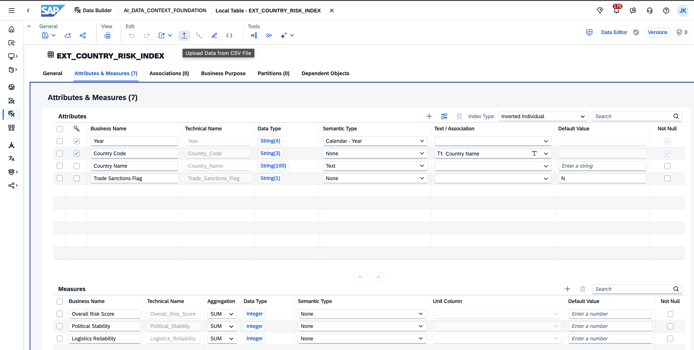

### Step 6: Expose OData Services

In SAP Datasphere, expose the following OData services for consumption. Ensure the analytical and relational endpoints are activated for Space `AI_DATA_CONTEXT_FOUNDATION`:

| Object | Type | OData Endpoint |
|---|---|---|
| `AM_PO_HISTORY` | Analytical | `/api/v1/datasphere/consumption/analytical/AI_DATA_FOUNDATION/AM_PO_HISTORY/AM_PO_HISTORY` |
| `V_SUPPLIER` | Relational | `/api/v1/datasphere/consumption/relational/AI_DATA_FOUNDATION/V_SUPPLIER/V_SUPPLIER` |
| `AM_SUPPLIER_RISK_SCORE` | Analytical | `/api/v1/datasphere/consumption/analytical/AI_DATA_FOUNDATION/AM_SUPPLIER_RISK_SCORE/AM_SUPPLIER_RISK_SCORE` |

> **Note:** To expose an OData service in SAP Datasphere, navigate to the respective Analytic Model or View, open the properties, and enable **Expose for Consumption**. Refer to [SAP Datasphere — Consuming Data via OData](https://help.sap.com/docs/SAP_DATASPHERE/43509d67b8b84e66a30851e832f66911/7a453609c8694b029493e7d87e0de60a.html) for detailed steps.

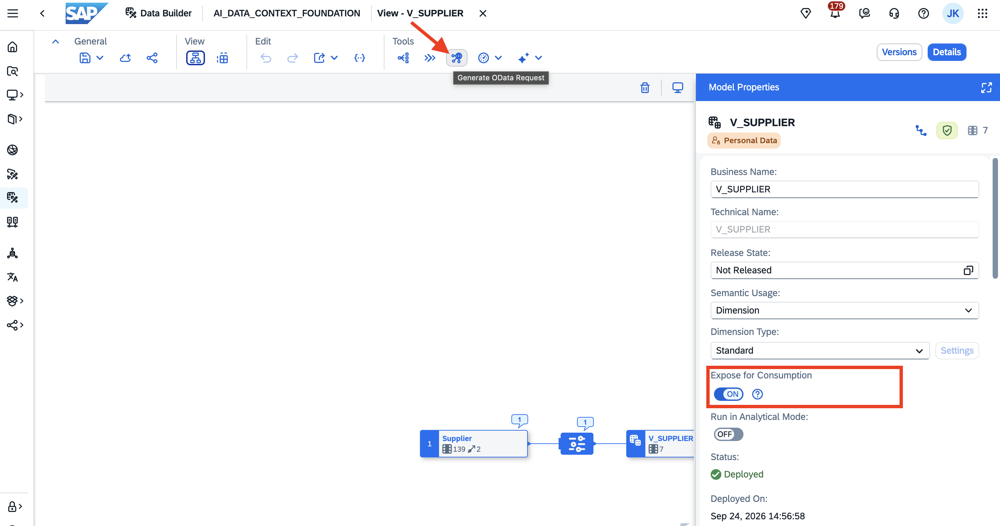

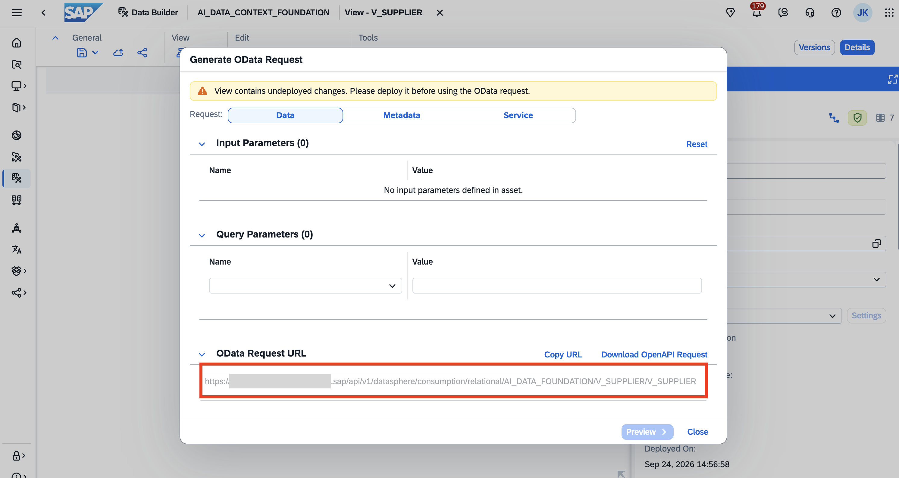

### Step 7: Configure BTP Destination and Trust

Set up the integration between SAP Datasphere and SAP BTP Destination Service. Refer to [How to Consume SAP Datasphere Analytical Models Using OData Services: Part 1 and Part 2 sections only](https://community.sap.com/t5/technology-blog-posts-by-sap/how-to-consume-sap-datasphere-analytical-models-to-sap-fiori-using-odata/ba-p/14445184) for detailed steps.

1. **Expose the Analytical Model for Consumption**

2. **Establish Trust Between Datasphere and BTP**

   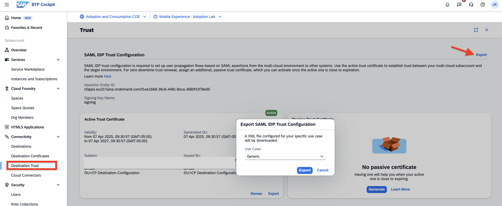

   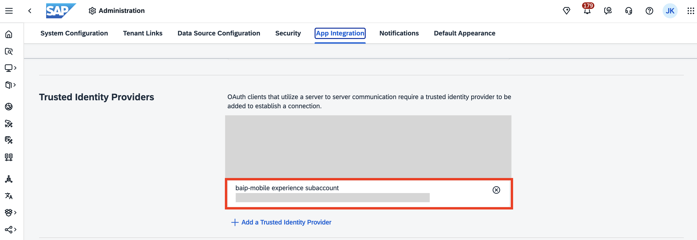

3. **Configure OAuth in SAP Datasphere** — Choose OAuth Client Purpose: `API Access` or `Technical User` that fits your scenario.

   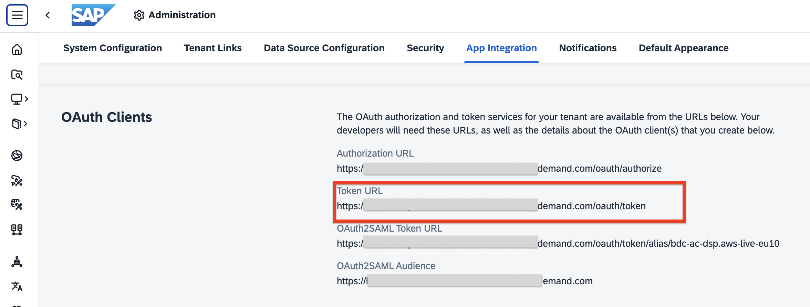

   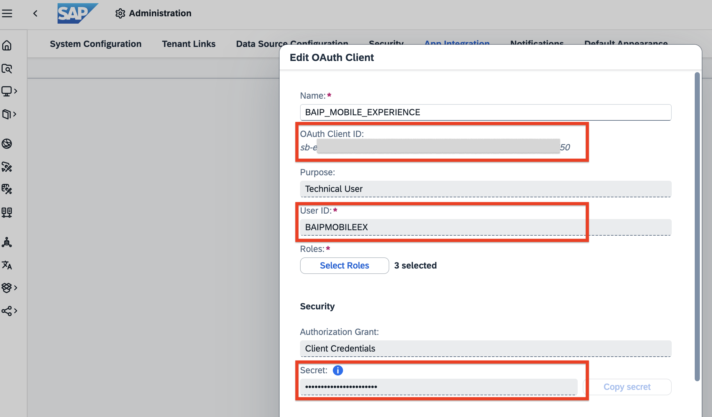

### Step 8: Create BTP Destination and Service Instances

- **Destination Service** instance with a configured SAP Datasphere destination — Type: `HTTP`, Name: `BDC-AI-Data-Foundation`.

  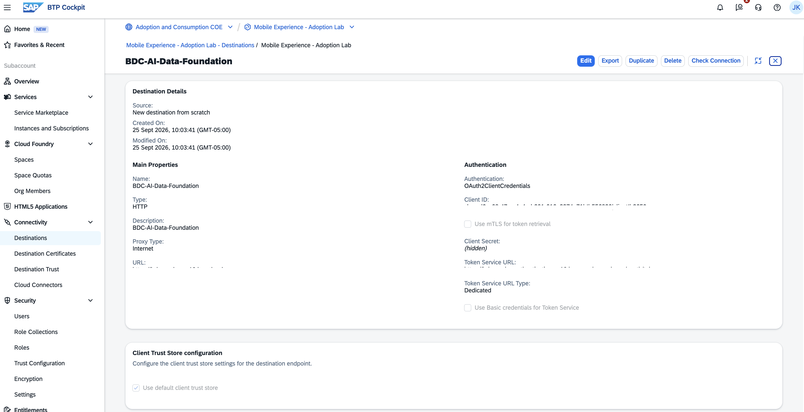

  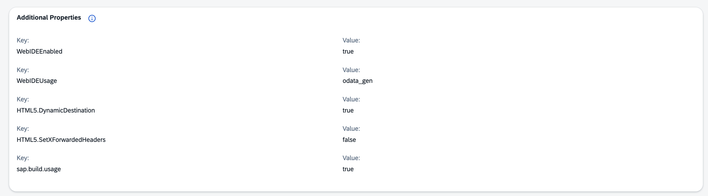

- **Connectivity Service** instance bound to the CF app — Service: `Destination Service`, Plan: `lite`, Runtime Environment: `Cloud Foundry`, Name: `module3_bdc`.

  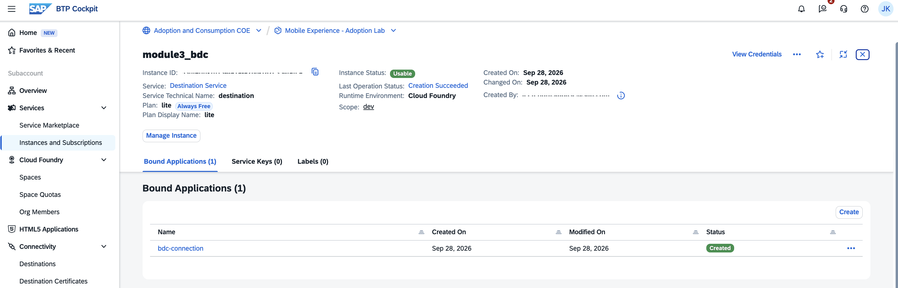

### Additional Prerequisites

- The SAP BTP Cloud Foundry CLI (`cf`) installed and logged in.
- A GitHub account to clone the repository.
- Basic familiarity with Python and Jupyter notebooks.

---

## Section 1: Clone & Create the Application

### Open SAP Business Application Studio

Before cloning the repository, you need a running SAP Business Application Studio / SAP Build Code dev space with Python support.

1. In SAP Business Application Studio, create a new dev space.
2. Name your dev space (e.g., `USERXXX_FullStack`).
3. Select **Full Stack Cloud Application** as the application type.
4. Under **Additional SAP Extensions**, enable **Python Tools**.
5. Click **Create Dev Space**.

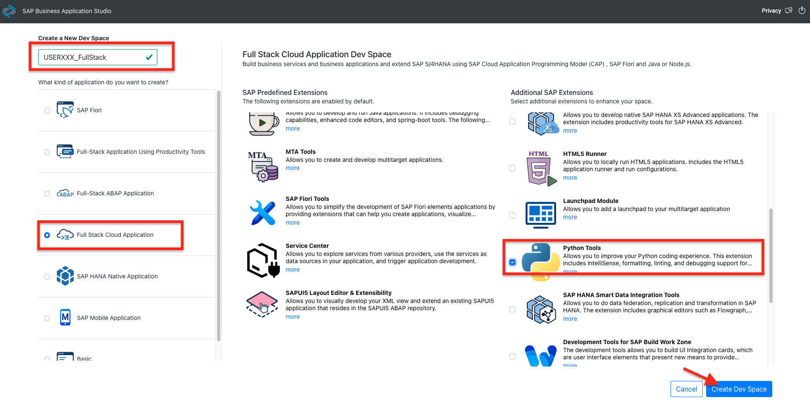

Wait for the dev space to show **RUNNING** status, then click on the dev space name to open it.

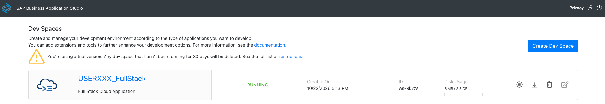

### Step 1: Clone the Git Repository

Once your dev space is open in the editor, click **Clone from Git**.

In the dialog, enter the following GitHub repository URL:

```
https://github.com/jeet-kapase-sap/2611_module3_bdc-main.git
```

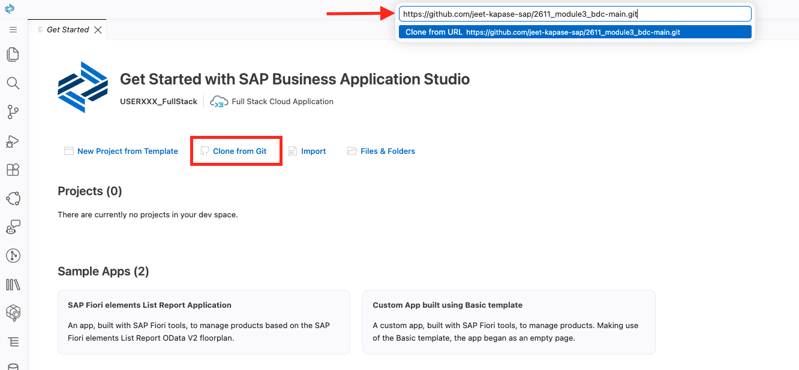

### Step 2: Open the Cloned Project

When prompted "Would you like to open the repository, or add it to the current workspace?", click **Open**.

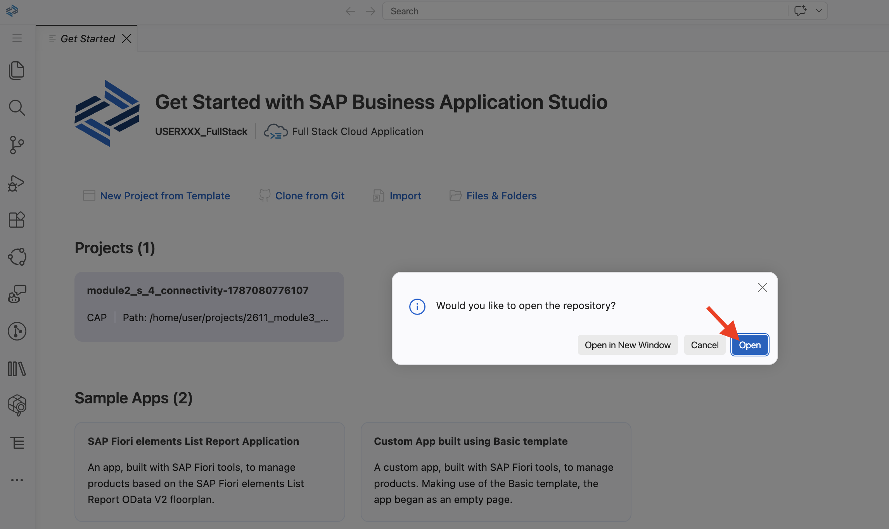

The project will open in SAP Business Application Studio.

### Step 3: Create the Environment Configuration File

Now you'll create a `.env` file to store your AI Core credentials securely.

1. In the Explorer panel, click the **create a new file** icon.
2. Name the file `.env` (including the dot at the beginning).

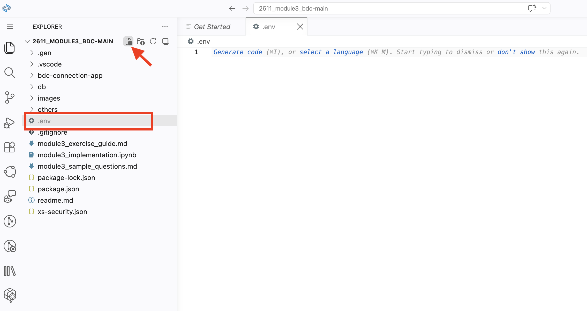

The `.env` file is now created. In the next section, you'll fill it with your AI Core credentials.

> [!NOTE]
> The `.env` file stores sensitive credentials locally and is automatically excluded from version control by the `.gitignore` file. Never commit this file to Git.

---

## Section 2: Configure Jupyter and Python Extensions

1. Open Jupyter Notebook `module3_implementation.ipynb` and Read through the notebook until you get to the first code cell in the **Before You Start** section..

   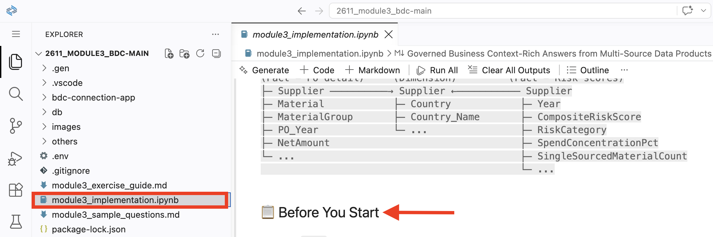

2. Create Virtual Python Environment.

    Open the terminal: **Terminal → New Terminal**
   ```bash
    python3 -m venv ~/venv
    ~/venv/bin/pip install python-dotenv pandas matplotlib requests ipykernel
    ~/venv/bin/python -m ipykernel install --user --name=venv --display-name="Python (venv)"
    ```
   
   

4. On the next screen, choose the recommended **Python 3.13**.
   
5. The required libraries will now start installing. Once the libraries have been successfully installed, the kernel must be restarted. Choose **Restart** in the menu at the top.
   
6. On the following pop-up window, choose **Restart**. It will take a few seconds for the kernel to restart. After it restarts, the environment is ready for use.
   
7. Follow the step-by-step instructions provided in the Jupyter Notebook to complete the remaining parts of the exercise.